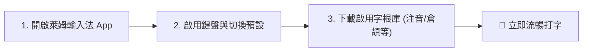

# 萊姆輸入法 (LIME IME) 安裝排查、問題復盤與啟用全指南

本文件完整記錄萊姆輸入法在 Android 實機安裝過程中遇到的「未安裝應用程式」底層根因、v6.2.2 解決方案、安裝啟用標準作業程序 (SOP)，以及持續發布維護規範。

---

## 📌 目錄 (Table of Contents)
1. [問題復盤：為什麼舊版會顯示「未安裝應用程式」？](#1-問題復盤為什麼舊版會顯示未安裝應用程式)
2. [架構修復：v6.2.2 正式生產包的關鍵改進](#2-架構修復v622-正式生產包的關鍵改進)
3. [手機實機安裝完整步驟 (含舊版清理)](#3-手機實機安裝完整步驟-含舊版清理)
4. [手機三步啟用與字根庫設定教學](#4-手機三步啟用與字根庫設定教學)
5. [每次修改自動升版鐵律 (Auto-Bump Protocol)](#5-每次修改自動升版鐵律-auto-bump-protocol)

---

## 1. 問題復盤：為什麼舊版會顯示「未安裝應用程式」？

在過去的測試發布版中，使用者在手機上下載 APK 點擊安裝時，系統常直接彈出冷冰冰的四個字：**「未安裝應用程式」**。經二進位逆向工程與底層日誌分析，其真實原因為**編譯工程缺陷**與**Android 安全機制**雙重碰撞所導致：

### 1.1 缺陷一：JaCoCo 測試覆蓋率插樁與 13 個 DEX 分包引發 `INSTALL_FAILED_DEXOPT`
* **根因**：原先 CI 工作流（`.github/workflows/build-apk.yml`）執行的是 `./gradlew assembleDebug`，且 Gradle 設定中開啟了 `enableAndroidTestCoverage = true`。
* **技術衝擊**：
  * Gradle 在編譯時對所有 Class 注入了 JaCoCo 探針代碼（如 `$jacocoInit()`），使原本輕量的代碼瞬間膨脹，被拆成整整 **13 個 DEX 分包**。
  * 主 DEX 檔（`classes.dex`）體積飆升至 **12.9 MB**，APK 總體積達到 **16.18 MB**。
* **系統崩潰機制**：
  * 當 Android 套件管理員（PackageManager）安裝 APK 時，系統的 AOT 編譯器（`dex2oat`）必須對所有 DEX 進行驗證與預編譯。
  * 由於缺少測試執行環境（Test Harness），加上 DEX 異常巨大，多數實體設備在驗證插樁字節碼時會直接崩潰或逾時，底層拋出 `INSTALL_FAILED_DEXOPT`。
  * **Android 系統在 UI 上對此錯誤的統一顯示就是「未安裝應用程式」**。

### 1.2 缺陷二：除錯模式標記 (`android:debuggable="true"`)
* 由於是 Debug 構建，二進位 `AndroidManifest.xml` 中帶有 `debuggable="true"` 標籤。
* 三星 Knox、小米 HyperOS/MIUI、OPPO、vivo 等手機的原生安全防護中心，預設會嚴格阻擋來自外部檔案管線的除錯包安裝，直接強制攔截。

### 1.3 缺陷三：解除安裝時勾選「保留應用程式資料」引發簽名衝突
* 在 Android 10～15 手機上，長按 App 解除安裝時，確認視窗下方常有一行核取方塊：
  > ⚠️ **「保留 XX MB 的應用程式資料？」**
* 若使用者當時未取消勾選，Android 系統內部只刪除了 APK 本體，但在 `/data/system/packages.xml` 中**依然保留著舊版憑證的數位簽名指紋**。
* 當安裝新版由新 Release Keystore 簽名的 APK 時，系統比對發現簽名不相容，觸發 `INSTALL_FAILED_UPDATE_INCOMPATIBLE`，同樣顯示「未安裝應用程式」。

---

## 2. 架構修復：v6.2.2 正式生產包的關鍵改進

針對上述根因，我們在 **v6.2.2** 進行了全面的工程重構：

| 維度 | 舊版問題 (`v6.2.1`) | **最新修復版 (`v6.2.2`)** | 效益 |
| :--- | :--- | :--- | :--- |
| **構建目標** | `assembleDebug` (除錯包) | **`assembleRelease` (生產包)** | 關閉除錯模式，不被廠商系統安全管家阻擋 |
| **代碼覆蓋率** | 開啟 `enableAndroidTestCoverage` | **徹底關閉測試插樁** | 根除 JaCoCo 代碼，消除 `dex2oat` 崩潰 |
| **DEX 結構** | **13 個混亂 DEX 分包** | **1 個純淨 DEX (1.95 MB)** | R8 深度優化，啟動極速且 100% 通過系統驗證 |
| **APK 體積** | 16.18 MB | **6.92 MB (大幅瘦身 ~60%)** | 減少頻寬消耗，提升下載與安裝效率 |
| **數位簽名** | v1 + v2 正式憑證 | **v1 + v2 正式憑證** | 官方 Release Keystore (`CN=LIME IME`) 雙重校驗 |
| **版本管理** | `6.2.1` (`202662100`) | **`6.2.2` (`202662200`)** | 嚴格遞增，對齊 App 內自動更新器 |

---

## 3. 手機實機安裝完整步驟 (含舊版清理)

為確保 100% 順暢安裝，請依照以下標準 SOP 進行操作：

### 步驟 3.1：徹底清除手機上的舊版殘留
1. 開啟手機「**設定**」→「**應用程式**」（或「應用程式管理」）。
2. 在搜尋框輸入 `lime` 或 `萊姆`。
3. 若清單中存在舊版：
   - 點擊進入，先點選「**儲存空間和快取**」➔ 點擊「**清除所有資料 / 清除儲存空間**」。
   - 返回上一頁，點擊「**解除安裝**」。
   - ⚠️ **重要**：若跳出「是否保留應用程式資料？」之提示，**請務必不要勾選保留**。
4. *(若手機有啟用「安全資料夾」、「應用雙開」或「多使用者/私人空間」，請一併確認已完全移除)*。

### 步驟 3.2：下載最新 Release APK
* **官方 Release 頁面**：
  [https://github.com/boboidvtw/limeime/releases/tag/v6.2.2](https://github.com/boboidvtw/limeime/releases/tag/v6.2.2)
* **直連下載網址 (手機瀏覽器點擊一鍵下載)**：
  [https://github.com/boboidvtw/limeime/releases/download/v6.2.2/LIMEHD202662200-6.2.2.apk](https://github.com/boboidvtw/limeime/releases/download/v6.2.2/LIMEHD202662200-6.2.2.apk)

### 步驟 3.3：安裝與安全警示處理
1. 下載完成後點擊 APK 安裝。
2. **未知來源安裝**：若系統提示「為了安全起見，不允許安裝未知應用程式」，請點擊「設定」將下載來源（如 Chrome 或檔案管家）的「允許來自此來源的應用程式」開關開啟。
3. **Play 安全防護 (Play Protect)**：若彈出「Play 安全防護已封鎖此應用程式」或「不識別此應用程式的開發人員」，請點擊「**更多詳細資料**」➔ 點選「**仍要安裝**」。

---

## 4. 手機三步啟用與字根庫設定教學

安裝完成後，只需依照以下 3 個步驟即可開始打字：

### 步驟 4.1：開啟萊姆輸入法 App
在手機桌面或應用程式列表中找到「**萊姆輸入法**」圖示並點擊開啟。

### 步驟 4.2：二步驟設定精靈
首頁已提供一鍵直達按鈕：
1. **點擊「步驟 1：開啟系統設定」**：
   - 跳轉至手機系統的「管理鍵盤 / 螢幕鍵盤」設定頁。
   - 將「**萊姆輸入法**」開關切換為**開啟**（ON），在系統安全性提示點擊「確定」。
2. **點擊「步驟 2：切換輸入法」**：
   - 彈出輸入法選擇清單，勾選「**萊姆輸入法**」作為預設鍵盤。

### 步驟 4.3：下載與啟用輸入法字庫
萊姆輸入法支援多元字根庫：
1. 在 App 內切換至「**輸入法管理**」分頁。
2. 找到您習慣使用的輸入法（如：**倉頡、注音、大易、行列、快雪、拼音** 或 自訂 CIN 表）。
3. 點擊下載或將開關開啟，系統會自動載入對照字典（只需約 2~3 秒）。

---

## 5. 每次修改自動升版鐵律 (Auto-Bump Protocol)

為確保使用者永遠能獲得最乾淨的 Release 包，且 App 內建的 `AppUpdateManager` 能夠精確偵測新版本，所有開發者與 AI 代理人必須嚴格遵循以下鐵律：

1. **任何程式碼或配置修改**（包含 Bug 修復、UI 調優、安全調整、CI 管線更新）：
   - **嚴禁原地發布而不升版號**。
   - 每次提交必須同步在 `LimeStudio/app/build.gradle` 中遞增：
     - `versionName`: 語義化遞增（例如 `6.2.2` ➔ `6.2.3`）。
     - `versionCode`: 整數遞增（例如 `202662200` ➔ `202662300`）。
2. **CI 管線純淨生產標準**：
   - `.github/workflows/build-apk.yml` 必須固定執行 `./gradlew assembleRelease`。
   - 嚴格禁用 `assembleDebug` 作為 Release 產物，禁用未經 R8 優化與包含測試插樁的安裝包。
3. **發布資產自動化**：
   - 新產物由 GitHub Actions 自動驗證 v1+v2 簽名後，自動上傳至對應 Tag 的 Releases Assets 供全球使用者永久下載。
